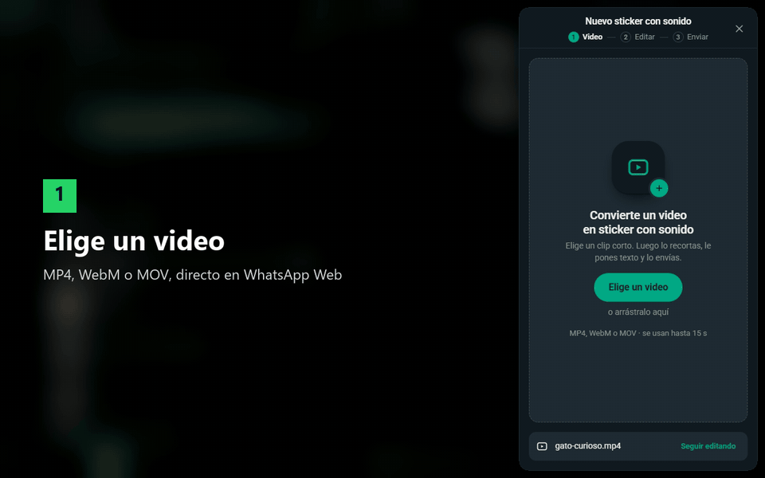
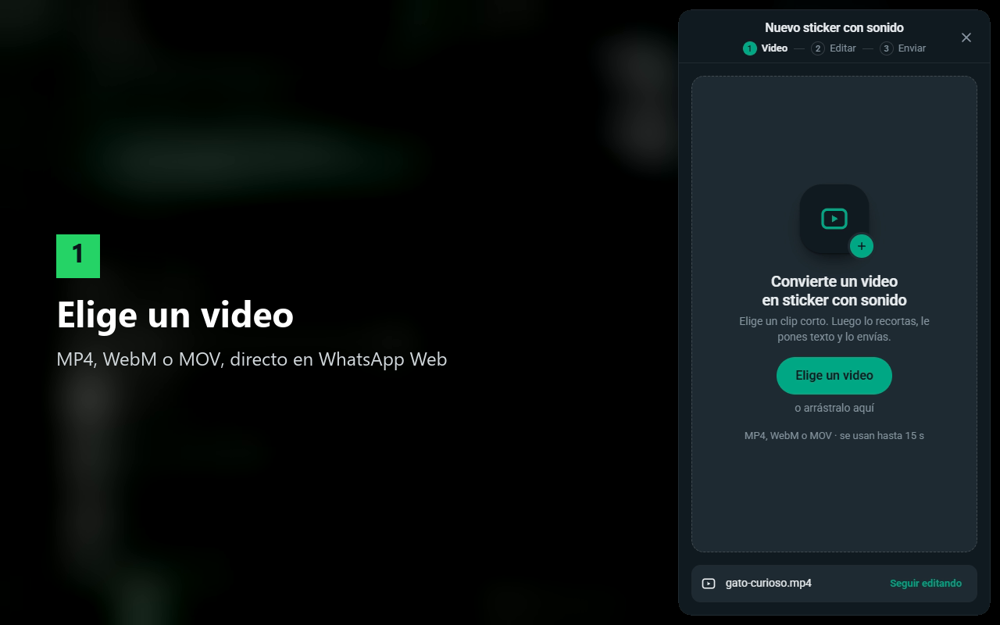
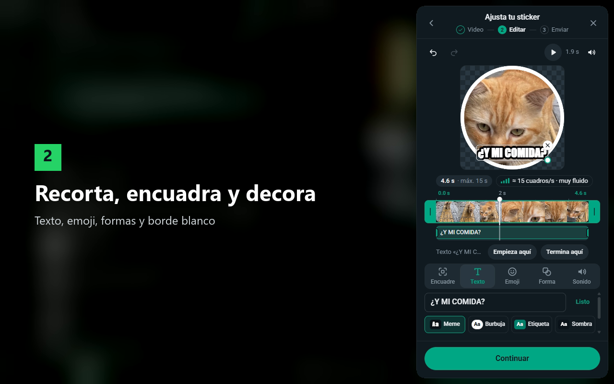
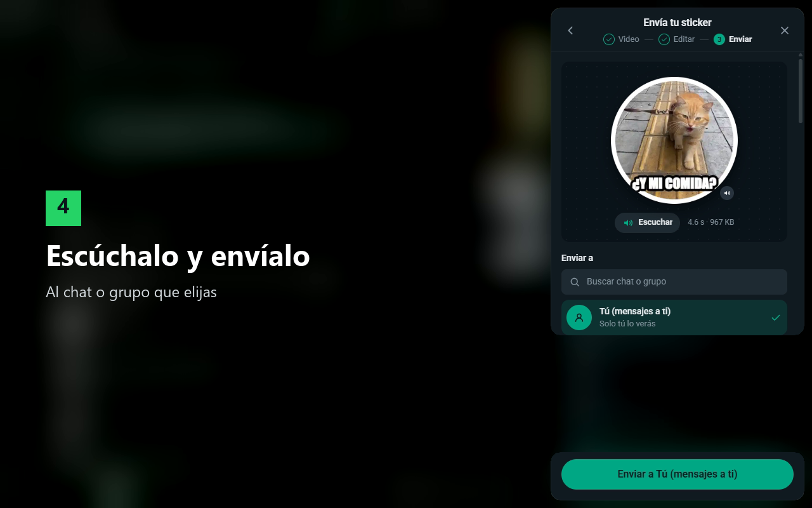
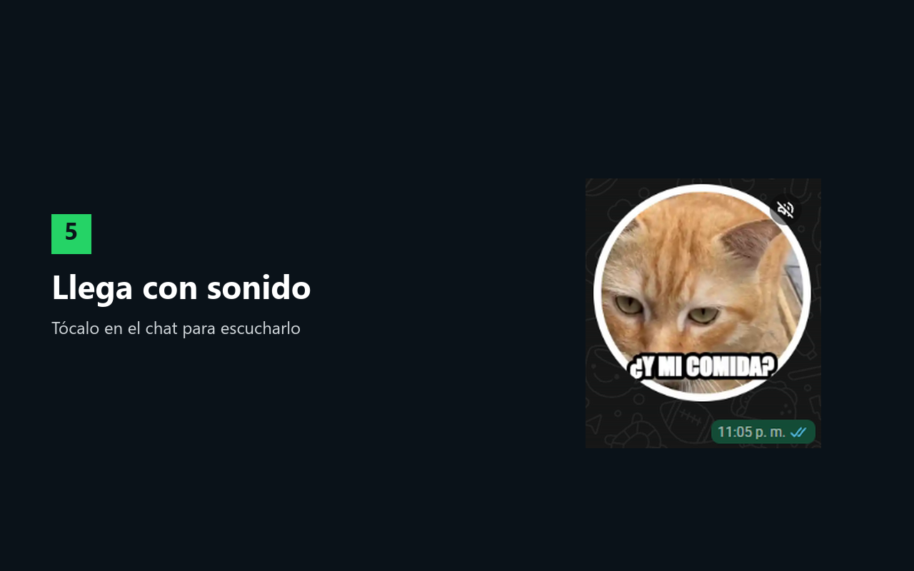
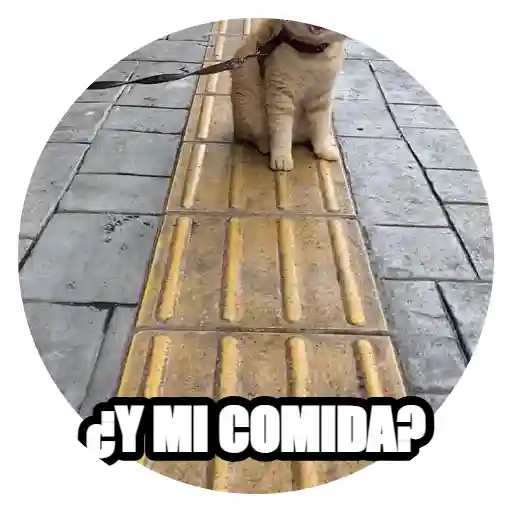

<div align="center">


# StickerVox

**Turn your videos into WhatsApp sound stickers, right from WhatsApp Web.**

[](https://github.com/xebastian153/stickervox/releases/latest)
[](LICENSE)
[](manifest.json)
[](package.json)
[](PRIVACY.md)

[Download](https://github.com/xebastian153/stickervox/releases/latest) ·
[Installation guide (Spanish)](docs/GUIA-INSTALACION.md) ·
[Report an issue](https://github.com/xebastian153/stickervox/issues)

[Español](README.md) · **English**



</div>

> [!IMPORTANT]
> **Unofficial project.** StickerVox is not affiliated with, endorsed by, or sponsored by WhatsApp or Meta. It relies on WhatsApp Web internals that can change without notice; if sending stops working, WhatsApp most likely shipped an update and a new StickerVox release is needed.

> [!NOTE]
> The extension interface is currently available in Spanish only.

## Table of contents

- [Features](#features)
- [How it works](#how-it-works)
- [Installation](#installation)
- [Usage](#usage)
- [Limits](#limits)
- [Privacy](#privacy)
- [Development](#development)
- [Contributing](#contributing)
- [License](#license)

## Features

| | Feature | Details |
|---|---|---|
| ✂️ | **Precise trimming** | Pick the exact segment (up to 15 s) on a zoomable thumbnail strip. |
| 🖼️ | **Free framing** | Drag and zoom the image to choose what stays in view. |
| 💬 | **Text and emoji** | Layers on top of the sticker with styles (meme, bubble, label, shadow), colors and timing. |
| ⭕ | **Shapes** | Square, rounded or circle, with an optional white outline. |
| 📈 | **Smoothness estimate** | Shows the expected frame rate before building, or how many seconds fit. |
| 🔊 | **Clean audio** | Optional loudness normalization and short fades to avoid clicks. |
| 📤 | **Direct sending** | Preview the result and send it to any chat or group. |

## How it works

<table>
  <tr>
    <td align="center" width="50%"><br><b>1. Video</b><br>Pick or drop an MP4, WebM or MOV file.</td>
    <td align="center" width="50%"><br><b>2. Edit</b><br>Trim, frame and decorate; the estimate tells you how smooth it will be.</td>
  </tr>
  <tr>
    <td align="center" width="50%"><br><b>3. Send</b><br>Listen, choose the chat and send.</td>
    <td align="center" width="50%"><br><b>4. Done</b><br>It arrives in the chat as a sound sticker.</td>
  </tr>
</table>

### Real example



This is the sticker from the screenshots, exactly as WhatsApp receives it: a 512 × 512 animated WebP, 4.6 s long, about 930 KB, at 15 frames per second. It was made with StickerVox from a [free Pexels video](https://www.pexels.com/video/4427731/).

<br clear="right">

Everything happens in your browser: each frame is drawn on a 512 × 512 canvas and packed into an **animated WebP** (using delta frames to save space), while the sound is encoded as **Ogg/Opus** with WebCodecs. When a clip does not fit the size limit, StickerVox lowers image quality first and frame rate second, always favoring smooth playback.

## Installation

**Requirements:** Microsoft Edge, Google Chrome or Brave **116 or newer** on a desktop computer, plus [WhatsApp Web](https://web.whatsapp.com). It does not work on mobile or in the WhatsApp desktop app.

### Option A · Microsoft Edge Add-ons

Coming soon to the Edge store, with one-click installation and automatic updates.
<!-- TODO: add the Microsoft Edge Add-ons link once the listing is approved -->

### Option B · ZIP (Edge, Chrome or Brave)

1. Download `StickerVox-vX.Y.Z.zip` from [Releases](https://github.com/xebastian153/stickervox/releases/latest) and extract it to a permanent folder (for example, `Documents\StickerVox`).
2. Open `edge://extensions`, `chrome://extensions` or `brave://extensions`.
3. Turn on **Developer mode**.
4. Click **Load unpacked** and select the folder that contains `manifest.json`.
5. Pin the StickerVox icon and reload the WhatsApp Web tab.

## Usage

1. Open WhatsApp Web and click the **StickerVox** icon.
2. Choose a video and adjust the segment, framing, text and shape.
3. Check the smoothness estimate and click **Continuar** (Continue).
4. Listen to the result, pick a chat and click **Enviar a …** (Send to …).

> [!TIP]
> For your first try, send it to yourself: your own chat appears as **«Tú (mensajes a ti)»** (You, messages to yourself).

## Limits

| Limit | Value | What happens when exceeded |
|---|---|---|
| Duration | 15 s per sticker | The segment selector stops at that length. |
| Sticker size | < 1000 KB | Quality and frame rate are reduced; if it still does not fit, a shorter segment is suggested. |
| Resolution | 512 × 512 px | Framing adapts to this size. |
| Long videos | No practical limit | Supported, but the segment audio is recorded in real time: keep the tab in front while building. |
| Recipient | WhatsApp with sound sticker support | Older versions show the animated sticker without sound. |

## Privacy

StickerVox **has no servers, no analytics, stores no data, and makes no network requests of its own.** The only thing that leaves your computer is the sticker you choose to send, and WhatsApp Web itself sends it. The only host permission is `https://web.whatsapp.com/*`. See the [privacy policy](PRIVACY.md) for details.

## Development

Plain JavaScript, no dependencies, no build step.

```bash
git clone https://github.com/xebastian153/stickervox.git
cd stickervox
npm test   # unit tests for the pure modules with node --test (Node 22+)
```

To try it, load the repository folder as an unpacked extension and open WhatsApp Web.

```text
stickervox/
├── manifest.json        # Manifest V3
├── background.js        # service worker: toolbar button
└── src/
    ├── relay.js         # bridge between the extension and the page
    ├── core.js          # shared namespace
    ├── media/           # animated WebP, Ogg/Opus, audio, rendering and sticker build
    ├── wa/bridge.js     # WhatsApp Web integration (chats and sending)
    ├── ui/              # panel: model, styles and views (Shadow DOM)
    └── main.js          # bootstrap
```

Module contracts are documented in [docs/ARCHITECTURE.md](docs/ARCHITECTURE.md).

## Contributing

Bug reports and ideas are welcome in [Issues](https://github.com/xebastian153/stickervox/issues). When reporting a bug, include your browser and version, the video you used (length and format), and the message you saw. For code changes, open a pull request with tests covering the new behavior and make sure `npm test` passes.

## License

Released under the [MIT License](LICENSE). © 2026 Sebas ([@xebastian153](https://github.com/xebastian153)).

WhatsApp is a trademark of WhatsApp LLC. This project is not affiliated with WhatsApp LLC or Meta Platforms, Inc.
