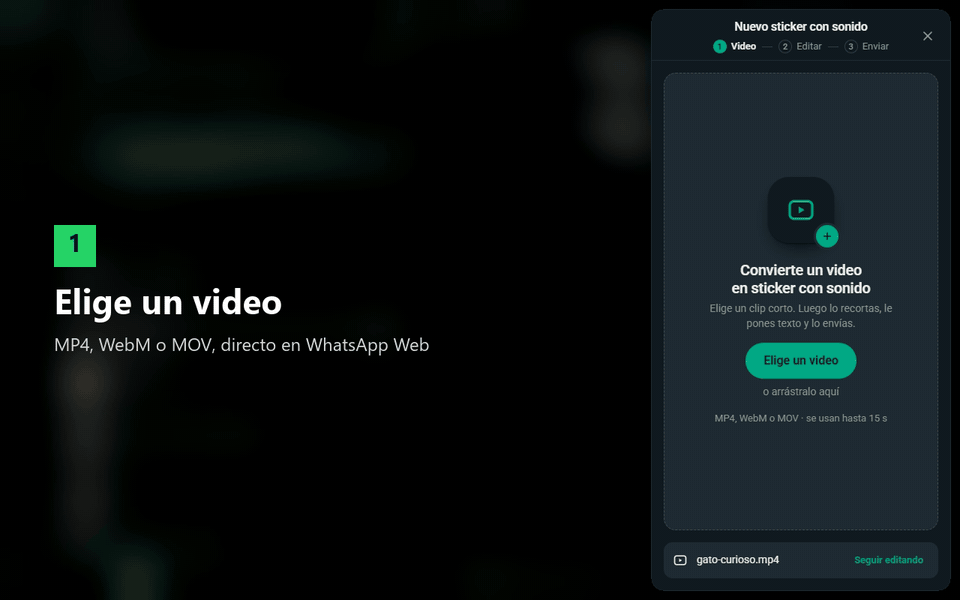
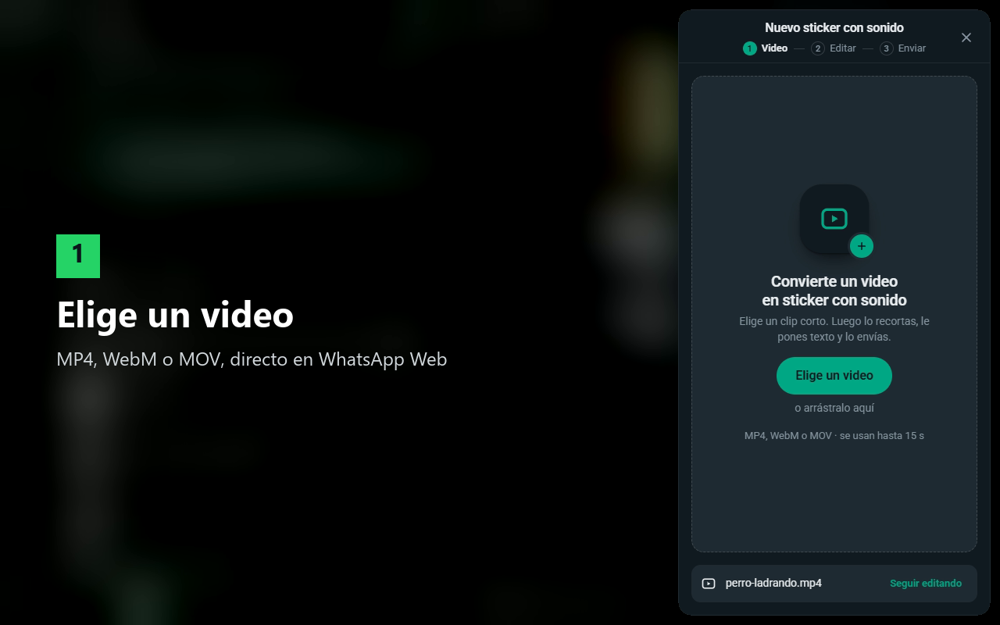
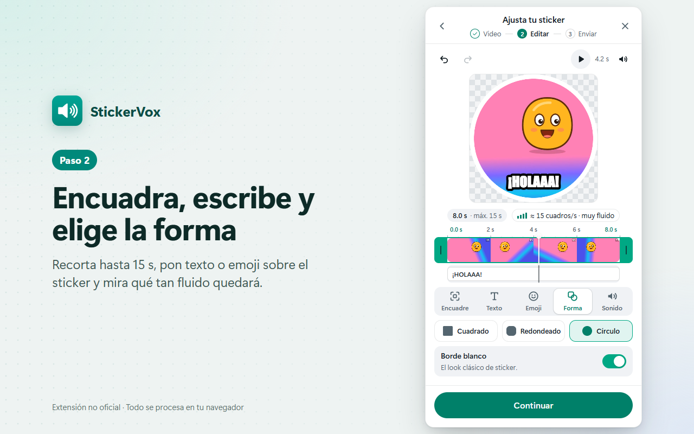
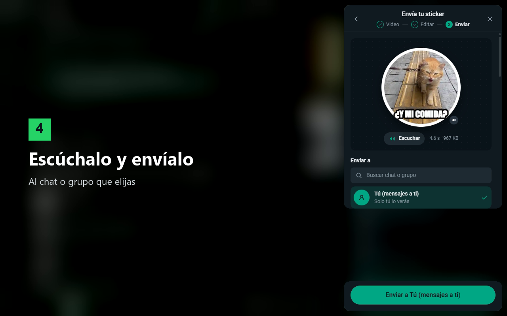
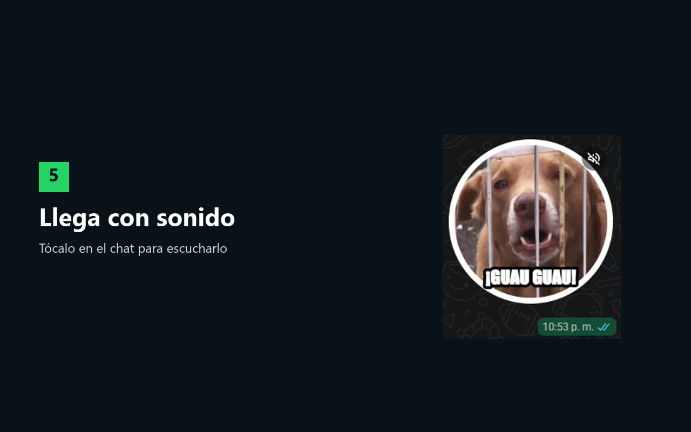
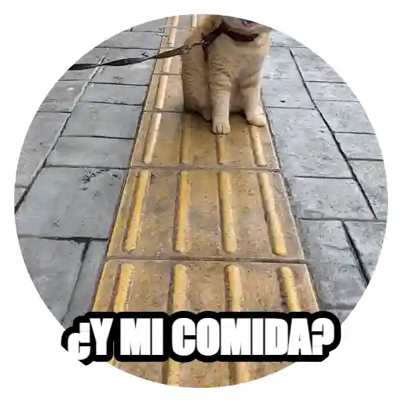

<div align="center">


# StickerVox

**Convierte tus videos en stickers con sonido para WhatsApp, directo desde WhatsApp Web.**

[](https://github.com/xebastian153/stickervox/releases/latest)
[](LICENSE)
[](manifest.json)
[](package.json)
[](PRIVACY.md)

[Descargar](https://github.com/xebastian153/stickervox/releases/latest) ·
[Guía de instalación](docs/GUIA-INSTALACION.md) ·
[Reportar un problema](https://github.com/xebastian153/stickervox/issues)

**Español** · [English](README.en.md)



</div>

> [!IMPORTANT]
> **Proyecto no oficial.** StickerVox no tiene relación con WhatsApp ni con Meta, ni cuenta con su respaldo. Usa partes internas de WhatsApp Web que pueden cambiar sin aviso; si deja de enviar, lo más probable es que WhatsApp se haya actualizado y haga falta una versión nueva.

## Tabla de contenido

- [Características](#características)
- [Cómo funciona](#cómo-funciona)
- [Instalación](#instalación)
- [Uso](#uso)
- [Límites](#límites)
- [Privacidad](#privacidad)
- [Desarrollo](#desarrollo)
- [Contribuir](#contribuir)
- [Licencia](#licencia)

## Características

| Función | Detalle |
|---|---|
| **Recorte preciso** | Elige el tramo exacto (hasta 15 s) sobre una tira de miniaturas con zoom. |
| **Encuadre libre** | Arrastra y acerca la imagen para decidir qué se ve. |
| **Texto y emoji** | Capas sobre el sticker con estilos (meme, burbuja, etiqueta, sombra), colores y momento de aparición. |
| **Formas** | Cuadrado, redondeado o círculo, con borde blanco opcional. |
| **Indicador de fluidez** | Antes de crear el sticker muestra los cuadros por segundo esperados, o cuántos segundos caben. |
| **Audio cuidado** | Normalización opcional y fundidos suaves para evitar clics. |
| **Envío directo** | Escúchalo y envíalo al chat o grupo que elijas. |

## Cómo funciona

<table>
  <tr>
    <td align="center" width="50%"><br><b>1. Video</b><br>Elige o arrastra un MP4, WebM o MOV.</td>
    <td align="center" width="50%"><br><b>2. Editar</b><br>Recorta, encuadra y decora; el indicador te dice qué tan fluido saldrá.</td>
  </tr>
  <tr>
    <td align="center" width="50%"><br><b>3. Enviar</b><br>Escúchalo, elige el chat y envíalo.</td>
    <td align="center" width="50%"><br><b>4. Listo</b><br>Llega al chat como sticker con sonido.</td>
  </tr>
</table>

### Ejemplo real



Este es el sticker de las capturas, tal como lo recibe WhatsApp: WebP animado de 512 × 512, 4,6 s, unos 930 KB y a 15 cuadros por segundo. Se hizo con StickerVox a partir de un [video libre de Pexels](https://www.pexels.com/video/4427731/).

<br clear="right">

Todo ocurre en tu navegador: cada cuadro se dibuja en un lienzo de 512 × 512, se empaqueta como **WebP animado** (con cuadros delta para ahorrar peso) y el sonido se codifica en **Ogg/Opus** con WebCodecs. Si el clip no cabe en el límite, StickerVox baja primero la calidad y después los cuadros por segundo, priorizando siempre la fluidez.

## Instalación

**Requisitos:** Microsoft Edge, Google Chrome o Brave **116 o más nuevo**, en computadora, con [WhatsApp Web](https://web.whatsapp.com). No funciona en el celular ni en la app de escritorio de WhatsApp.

### Opción A · Microsoft Edge Add-ons

Próximamente en la tienda de Edge, con instalación de un clic y actualizaciones automáticas.
<!-- TODO: agregar el enlace de Microsoft Edge Add-ons cuando la tienda apruebe la extensión -->

### Opción B · ZIP (Edge, Chrome o Brave)

1. Descarga `StickerVox-vX.Y.Z.zip` desde [Releases](https://github.com/xebastian153/stickervox/releases/latest) y descomprímelo en una carpeta permanente (por ejemplo, `Documentos\StickerVox`).
2. Abre `edge://extensions`, `chrome://extensions` o `brave://extensions`.
3. Activa el **Modo de desarrollador**.
4. Pulsa **Cargar desempaquetada** y elige la carpeta que contiene `manifest.json`.
5. Fija el ícono de StickerVox y recarga la pestaña de WhatsApp Web.

¿Primera vez instalando una extensión? La [guía paso a paso](docs/GUIA-INSTALACION.md) explica cada pantalla y los problemas frecuentes.

## Uso

1. Abre WhatsApp Web y pulsa el ícono de **StickerVox**.
2. Elige un video y ajusta tramo, encuadre, texto y forma.
3. Revisa el indicador de fluidez y pulsa **Continuar**.
4. Escucha el resultado, elige el chat y pulsa **Enviar a …**.

> [!TIP]
> Para la primera prueba, envíatelo a ti mismo: en la lista aparece como **«Tú (mensajes a ti)»**.

## Límites

| Límite | Valor | Qué pasa si se supera |
|---|---|
| Duración | 15 s por sticker | El selector de tramo no deja pasar de ahí. |
| Peso del sticker | < 1000 KB | Se ajustan calidad y cuadros por segundo; si aun así no cabe, sugiere un tramo más corto. |
| Resolución | 512 × 512 px | El encuadre se adapta a este tamaño. |
| Videos largos | Sin límite práctico | Funciona, pero el audio se graba en tiempo real: quédate en la pestaña mientras se crea. |
| Destinatario | WhatsApp con stickers con sonido | En versiones antiguas se ve el sticker animado, sin sonido. |

La interfaz está en español.

## Privacidad

StickerVox **no tiene servidores, no usa analítica, no guarda datos y no hace peticiones de red propias.** Lo único que sale de tu computadora es el sticker que tú decides enviar, y lo envía el propio WhatsApp Web. Solo pide acceso a `https://web.whatsapp.com/*`. Más detalles en la [política de privacidad](PRIVACY.md).

## Desarrollo

JavaScript puro, sin dependencias ni paso de compilación.

```bash
git clone https://github.com/xebastian153/stickervox.git
cd stickervox
npm test   # pruebas de los módulos puros con node --test (Node 22+)
```

Para probarla, carga la carpeta del repositorio como extensión desempaquetada y abre WhatsApp Web.

```text
stickervox/
├── manifest.json        # Manifest V3
├── background.js        # service worker: botón de la barra
└── src/
    ├── relay.js         # puente entre la extensión y la página
    ├── core.js          # espacio de nombres compartido
    ├── media/           # WebP animado, Ogg/Opus, audio, render y armado del sticker
    ├── wa/bridge.js     # integración con WhatsApp Web (chats y envío)
    ├── ui/              # panel: modelo, estilos y vistas (Shadow DOM)
    └── main.js          # arranque
```

Los contratos entre módulos están documentados en [docs/ARCHITECTURE.md](docs/ARCHITECTURE.md).

## Contribuir

Los reportes de errores y las ideas son bienvenidos en [Issues](https://github.com/xebastian153/stickervox/issues). Al reportar un error, incluye el navegador y su versión, qué video usaste (duración y formato) y el mensaje que apareció. Para cambios de código, abre un pull request con pruebas que cubran el comportamiento nuevo y verifica que `npm test` pase.

## Licencia

Distribuido bajo la [licencia MIT](LICENSE). © 2026 Sebas ([@xebastian153](https://github.com/xebastian153)).

WhatsApp es una marca registrada de WhatsApp LLC. Este proyecto no está afiliado a WhatsApp LLC ni a Meta Platforms, Inc.

