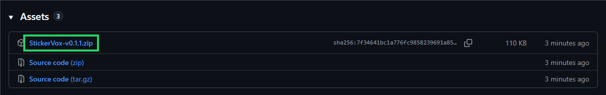
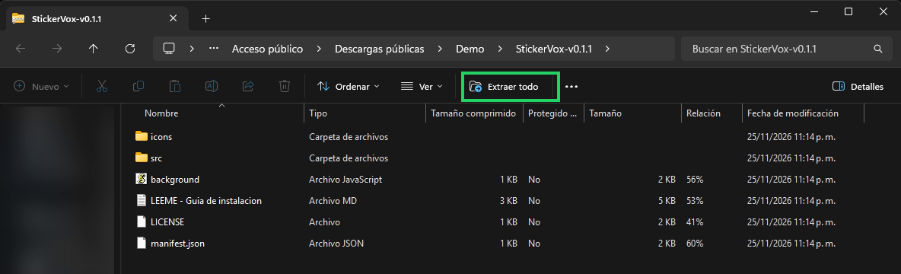
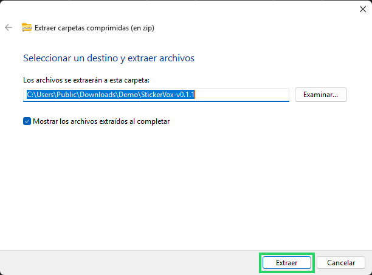
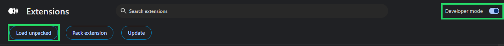
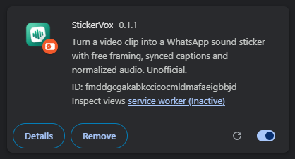
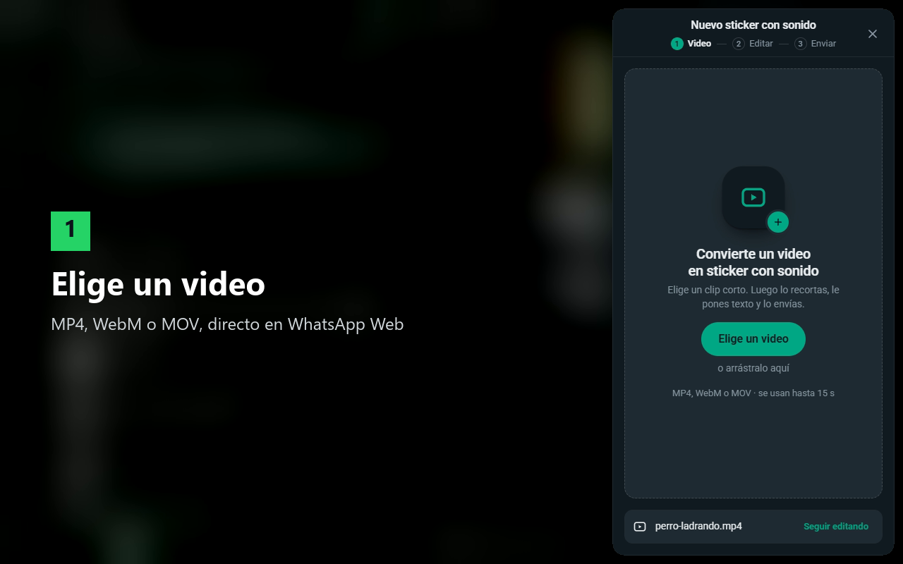
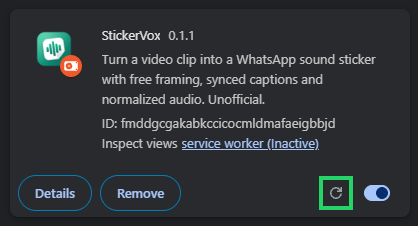

# StickerVox · Guía de instalación

> **Versión con imágenes:** https://github.com/xebastian153/stickervox/blob/main/docs/GUIA-INSTALACION.md

StickerVox convierte un video corto en un **sticker con sonido para WhatsApp**, desde WhatsApp Web. Instalarla toma unos 5 minutos y se hace una sola vez.

> **Extensión no oficial.** StickerVox no tiene relación con WhatsApp ni con Meta. Usa partes internas de WhatsApp Web que pueden cambiar; si un día deja de enviar, espera una versión nueva.

## Antes de empezar

| Necesitas | Detalle |
|---|---|
| Una computadora | No funciona en el celular. |
| Microsoft Edge, Google Chrome o Brave | Versión 116 o más nueva. |
| WhatsApp Web | Abierto en https://web.whatsapp.com (no la app de escritorio). |

---

## Paso 1 · Descarga el ZIP

Entra a la [página de descargas](https://github.com/xebastian153/stickervox/releases/latest), baja hasta **Assets** y pulsa el archivo **StickerVox-vX.Y.Z.zip** (el número cambia con cada versión).

> No descargues "Source code": ese es el código fuente, no la extensión lista para usar.

## Paso 2 · Descomprime el ZIP

1. Abre la carpeta **Descargas** y haz doble clic en el ZIP.
2. Pulsa **Extraer todo** en la barra de arriba.

3. Elige dónde guardarla y pulsa **Extraer**. Te recomendamos una carpeta fija, por ejemplo `Documentos\StickerVox`: pulsa **Examinar…** para cambiarla.

> **Importante:** no borres ni muevas esa carpeta después. El navegador la usa todo el tiempo; si desaparece, la extensión deja de funcionar.

## Paso 3 · Activa el modo de desarrollador

Escribe en la barra de direcciones del navegador y pulsa Enter:

| Navegador | Dirección |
|---|---|
| Microsoft Edge | `edge://extensions` |
| Google Chrome | `chrome://extensions` |
| Brave | `brave://extensions` |

Activa el interruptor **Modo de desarrollador**. En Chrome y Brave está arriba a la derecha; en Edge, en el menú de la izquierda.

## Paso 4 · Carga la extensión

Pulsa **Cargar desempaquetada** (en Chrome: **Cargar descomprimida**) y elige la carpeta que descomprimiste en el paso 2: la que tiene adentro el archivo `manifest.json`.

*La captura está en inglés: "Developer mode" es el modo de desarrollador y "Load unpacked" es cargar desempaquetada.*

Si todo salió bien, aparece la tarjeta de StickerVox con su logo verde:

## Paso 5 · Fija el ícono

Pulsa el ícono de **pieza de rompecabezas** de la barra del navegador (arriba a la derecha) y luego el **pin** junto a StickerVox. Así el ícono queda siempre a la vista.

Si ya tenías WhatsApp Web abierto, **recarga esa pestaña** con la tecla F5.

## Paso 6 · Crea tu primer sticker

Abre WhatsApp Web y pulsa el ícono de StickerVox. Se abre un panel a la derecha:

1. **Video:** pulsa **Elige un video** o arrastra el archivo (MP4, WebM o MOV).
2. **Editar:** mueve los bordes verdes para elegir el tramo (hasta 15 s), encuadra la imagen y agrega texto o emoji. Junto a la duración verás qué tan fluido saldrá.
3. **Enviar:** pulsa **Continuar**, escúchalo, elige el chat y pulsa **Enviar a …**.

> Para la primera prueba envíatelo a ti: en la lista aparece como **"Tú (mensajes a ti)"**.

---

## Actualizar a una versión nueva

1. Descarga el ZIP nuevo y descomprímelo **en la misma carpeta**, reemplazando los archivos.
2. En la página de extensiones, pulsa el botón de **recargar** de StickerVox.
3. Recarga la pestaña de WhatsApp Web.

## Desinstalar

En la página de extensiones, pulsa **Quitar** en StickerVox. Después puedes borrar la carpeta.

## Problemas frecuentes

| Problema | Solución |
|---|---|
| No aparece el botón "Cargar desempaquetada" | Activa primero el **Modo de desarrollador** (paso 3). |
| Dice "No se encontró el archivo de manifiesto" | Elegiste una carpeta equivocada. Elige la que tiene `manifest.json` adentro, no la de más arriba. |
| El ícono no abre nada | Recarga la pestaña de WhatsApp Web (F5). |
| Dice "Esperando a WhatsApp Web…" | Espera a que aparezcan tus chats. Si no pasa, cierra y vuelve a abrir WhatsApp Web. |
| "No cabe · acorta a ~X s" | El tramo tiene mucho movimiento para el límite de 1 MB: elige uno más corto. |
| "WhatsApp no pudo enviar el sticker" | Revisa tu conexión e intenta de nuevo. Si sigue fallando, probablemente WhatsApp se actualizó: espera una versión nueva. |
| El navegador avisa sobre extensiones en modo de desarrollador | Es normal en extensiones instaladas desde un ZIP. Puedes cerrar el aviso. |
| La extensión desapareció | Probablemente moviste o borraste la carpeta. Repite los pasos 2 a 4. |
| Tenía otra extensión de stickers con sonido | Desactívala para que no se crucen los paneles. |

## Bueno saber

- **Quien lo recibe** necesita una versión de WhatsApp con stickers con sonido; si no la tiene, verá el sticker animado sin sonido. El sonido suena al tocar el sticker.
- **Videos largos** (por ejemplo, una película) funcionan, pero crear el sticker tarda un poco más. Quédate en la pestaña de WhatsApp mientras se crea.
- **Privacidad:** todo se procesa en tu computadora. StickerVox no envía nada a ningún servidor; solo se sube a WhatsApp el sticker que tú envías.
